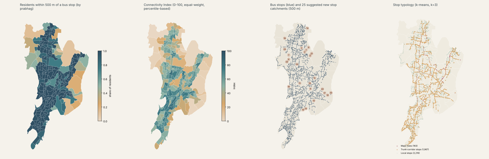

# Mumbai Passenger Mobility Intelligence System

A Streamlit app that analyses Mumbai's scheduled bus network. It plans journeys, measures how many residents live near a bus stop, and points out the areas that are poorly connected. It uses only open data. It does not use synthetic data, live bus positions, actual arrival times or passenger counts: every time shown comes from the published timetable.



*From left to right: share of residents within 500 m of a stop, connectivity index, suggested new-stop areas, and stop types.*

## What the app does

**Journey Explorer**
- Choose a start, a destination, a date and a time to get up to six scheduled bus options.
- Each option shows transfers, walking time, waiting time and a route map.
- It also gives a door-to-door time summary and an approximate BEST fare range.
- A "Where can I reach?" map shows which stops can be reached in 15 to 90 minutes.
- A "Nearest bus stops" tool finds stops near any point, with walking time, routes and next departures.

**Accessibility & Inclusion**
- Shows how many residents are within 300, 500 and 800 m of a stop, by ward.
- Shows how often buses run near people's homes during the morning peak.
- Compares coverage for Scheduled Caste and Scheduled Tribe residents and for slum areas.
- Checks access to colleges and public health facilities.

**Routes & Schedules**
- Shows each route's stops on a map, its trips and an hourly timetable.
- Includes a departure board for any stop and a check of which dates the timetable covers.

**Network Intelligence**
- Finds the most important stops in the network.
- Groups stops, routes and areas into types using k-means clustering.
- Scores every area on a connectivity index and highlights clusters of weak areas.
- Suggests 25 places where new stops would reach the most people.

## Getting started

```bash
git clone https://github.com/RaginiGupta21/mumbai-passenger-mobility-intelligence.git
cd mumbai-passenger-mobility-intelligence
python -m venv .venv
.venv\Scripts\activate
pip install -r requirements.txt
python -m streamlit run app.py
```

On macOS or Linux, activate the environment with `source .venv/bin/activate`. The app opens at http://localhost:8501. The processed data is included, so it starts straight away.

To rebuild all the data from the public sources (about 2 to 3 minutes), run `bash scripts/run_pipeline.sh`.

## Results

These results are for Greater Mumbai and the bus network only.

- 90.5% of residents are within 500 m of a bus stop (77.4% within 300 m and 95.4% within 800 m).
- About 1.18 million residents have no stop within 500 m.
- The weakest wards are M-East, T, P-North and R-Central, with 73% to 80% coverage. These weak areas are clustered, not scattered (Moran's I = 0.33, p = 0.001).
- Where a stop exists, service is mostly frequent. Only about 67,000 residents live near a stop but get fewer than four trips per peak hour.
- Coverage for Scheduled Caste and Scheduled Tribe residents (88.5% and 85.3%) is a little lower than the city figure (90.5%), but the difference is not statistically significant at ward level.
- The Vasai-Virar (VVMT) network is not connected to the BEST and TMT network in this timetable.
- The 25 suggested new-stop areas would bring about 381,000 of those residents (32%) within 500 m of a stop.

The full list is in [docs/FINDINGS.md](docs/FINDINGS.md).

## Data

| Layer | Source | Licence |
|---|---|---|
| Bus timetable (BEST, TMT, KDMT, VVMT) | [croyla/mumbai-gtfs](https://github.com/croyla/mumbai-gtfs), valid 19 Aug 2026 to 15 Feb 2027 | MIT |
| Ward boundaries, population, slum clusters | [DataMeet](https://github.com/datameet/Municipal_Spatial_Data) | CC BY-SA 2.5 IN |
| Colleges and universities | OpenStreetMap contributors | ODbL |
| Public health facilities | MCGM open data | MCGM open data |
| BEST fare slabs (approximate) | News reports, saved in `data/reference/best_fares.json` | Not an official table |

More detail is in [docs/DATA_SOURCES.md](docs/DATA_SOURCES.md).

## Limitations

- Times are scheduled, not live. Most stop times in the feed are interpolated, so treat them as accurate to about 5 minutes.
- Only buses are included. Trains and the Metro are not.
- Walking distance is a straight line multiplied by 1.3, because no road network was used.
- Population is assumed to be spread evenly inside each ward area.
- The college list is incomplete, and the health facility coordinates are rounded to about 500 m.
- Fares are approximate and not official.
- The timetable has one pattern for all seven days, so weekdays and weekends cannot be compared.

More detail is in [docs/LIMITATIONS.md](docs/LIMITATIONS.md).

## Project structure

```
app.py              Streamlit entry point
src/                Journey planner, fares, nearest stops and one module per page
scripts/            Steps that build the data (00 to 08) and run_pipeline.sh
data/raw/           Source files
data/reference/     Editable fare table
data/processed/     Tables and maps produced by the scripts
powerbi/            Tables for a Power BI dashboard, with a guide
docs/               Methodology, data sources, data quality, findings, limitations
tests/              Automated tests
```

## Tests

```bash
python -m pytest -q tests/test_core.py
python tests/smoke_all_pages.py
```

The first command runs 23 checks on the data and the journey planner. The second opens every page and clicks the main controls.

## Credits

Contains data from OpenStreetMap contributors (ODbL), DataMeet Trust (CC BY-SA 2.5 IN), MCGM open data and croyla/mumbai-gtfs (MIT). The code is released under the [MIT License](LICENSE).