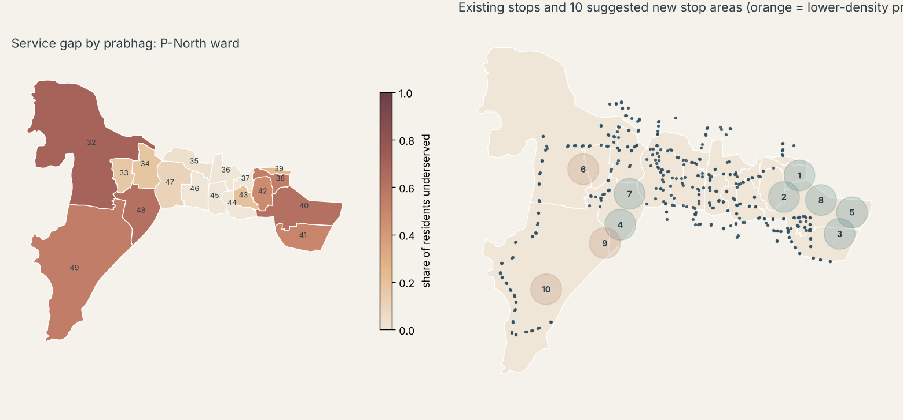

# Public Transport Demand and Service Gap Analysis: P-North Ward, Mumbai

**Live demo: https://mumbai-passenger-mobility-intelligence.streamlit.app/**

Mumbai's buses carry millions of trips a day, but bus service is not spread evenly across the city. Some areas have a stop on almost every street, while in others thousands of people live far from any stop. This project asks a simple question: in one residential ward, where do the most people have the least bus service?

This project looks at where residents of one Mumbai ward have too little bus service for the number of people who live there. It uses the published bus timetable and Census 2011 population. It does not use made-up data, live bus positions or passenger counts.



## Study area

**P-North ward** (the Malad area) is a mainly residential ward with 959,595 residents, split into 18 small areas called prabhags (16 of them densely populated).

I chose it by comparing wards on the same measure. Residents count as *underserved* if they have no bus stop within 500 m, or a stop but fewer than 10 scheduled bus trips per hour in the morning peak.

| Area | Residents | Underserved | No stop nearby | Stop but low frequency |
|---|---|---|---|---|
| Greater Mumbai | 12.44 million | 10.9% | 9.5% | 1.4% |
| **P-North** | 959,595 | **27.3%** | 22.7% | 4.6% |
| M-East | 814,543 | 27.1% | 26.9% | 0.2% |

P-North has the largest underserved population of the weakest wards, and it has both kinds of gap: stops that are too far away, and too few buses where stops exist.

## The two questions

1. **Where is the gap?** A map and chart showing, area by area, where many residents (demand) have too little bus service (supply).
2. **Where should it be fixed first?** A ranking of the areas that need attention and ten suggested places for new stops.

## How the gap is measured

- **Demand** is the number of residents in each prabhag (Census 2011). Passenger counts are not available, so residents stand in for demand.
- **Supply** is the distance to the nearest bus stop and the number of scheduled trips per hour (08:00 to 10:00) within 500 m. A trip that passes several nearby stops is counted once.
- **Underserved** residents have no stop within 500 m, or a stop but fewer than 10 trips per peak hour.
- Residents are spread evenly inside each prabhag on a 100 m grid.

## Findings

- 262,372 residents of P-North (27.3%) are underserved, compared with 10.9% across Greater Mumbai.
- 217,879 of them have no stop within 500 m, and 44,493 have a stop but low frequency.
- Morning peak service near residents averages about 98 trips per hour, against about 146 across the city.
- Five prabhags have half or more of their residents underserved: 32, 38, 40, 48 and 49.
- Among the dense residential prabhags, the most residents with no stop nearby are in 40 (about 33,000), 48 (about 28,000) and 38 (about 26,000).
- Ten suggested new stop areas would bring about 142,000 residents within 500 m of a stop (65% of those with none). Seven of the ten are in dense residential prabhags (about 123,000 residents). The other three (about 19,000) are in the large, sparsely built-up prabhags 32 and 49, so they need checking on the ground.

## How to run

```bash
git clone https://github.com/RaginiGupta21/mumbai-passenger-mobility-intelligence.git
cd mumbai-passenger-mobility-intelligence
python -m venv .venv
.venv\Scripts\activate
pip install -r requirements.txt
python -m streamlit run app.py
```

The processed data is included, so the app starts straight away with only the small `requirements.txt`. To rebuild the data from the raw files (about a minute), run the tests, or redraw the figure, install the extra libraries with `pip install -r requirements-dev.txt` and then run `python scripts/01_prepare_data.py`. To study a different ward, change `STUDY_WARD` in `src/config.py` (for example `"M - East"`) and run that script again.

## Data

| Data | Source | Licence |
|---|---|---|
| Bus timetable (BEST, TMT, KDMT, VVMT), valid 19 Aug 2026 to 15 Feb 2027 | [croyla/mumbai-gtfs](https://github.com/croyla/mumbai-gtfs) | MIT |
| Prabhag boundaries and Census 2011 population | [DataMeet](https://github.com/datameet/Municipal_Spatial_Data) | CC BY-SA 2.5 India |

Quality checks on the timetable are saved in `data/processed/data_quality.json`. The population adds up to 12,442,373, the Census 2011 total for Greater Mumbai.

## Project structure

```
app.py                      the two-page Streamlit app
src/config.py               settings (study ward, distances, peak hours)
src/gap.py                  helper functions for the app
scripts/01_prepare_data.py  builds all the data the app needs
scripts/02_make_figure.py   draws docs/overview.png
tests/                      automated checks
data/raw/                   source files
data/processed/             results used by the app
docs/METHOD.md              the method in more detail
```

## Limitations

- Residents stand in for demand. Real passenger counts would be better but are not openly available.
- Population is assumed to be spread evenly inside each prabhag. This is weakest in the large, sparsely built-up prabhags (32 and 49), where residents are probably clustered in a few places.
- Distances are straight lines. No road network or barriers (railway lines, creeks) are used.
- Times in the timetable are scheduled and partly interpolated (only 7.5% are official timepoints).
- Only buses are included, so areas near train or Metro stations may be better connected than shown.
- Population is from 2011 and the timetable is from 2026.
- The suggested stop areas are starting points for planners, not final locations.

## What the project showed

- **Coverage is not the whole story.** A stop nearby does not help much if only a few buses use it. That is why the gap has two parts: no stop nearby, and a stop with too few buses.
- **Counting needs care.** My first version counted a bus once for every stop it passed near a home, which made service look much better than it was. Counting each trip once fixed that.
- **Averages hide the picture.** Across the whole ward, about 27% of residents are underserved, but in prabhags 32, 38, 40, 48 and 49 it is half or more.
- **Assumptions matter.** Spreading residents evenly is reasonable in dense areas but weak in large, sparsely built-up ones, so some results are less certain. The app marks them.
- **Real data has problems.** The timetable has mostly estimated stop times and many routes with no trips. Checking this first stopped me from trusting it blindly.

## Branches

`main` is this simplified project. The branch `full-version` keeps my earlier, larger version with a journey planner, route pages, network analysis and a Power BI export.

## Credits

Contains data from DataMeet Trust (CC BY-SA 2.5 India) and croyla/mumbai-gtfs (MIT). Map tiles are © OpenStreetMap contributors. Code is released under the MIT License (see `LICENSE`).
