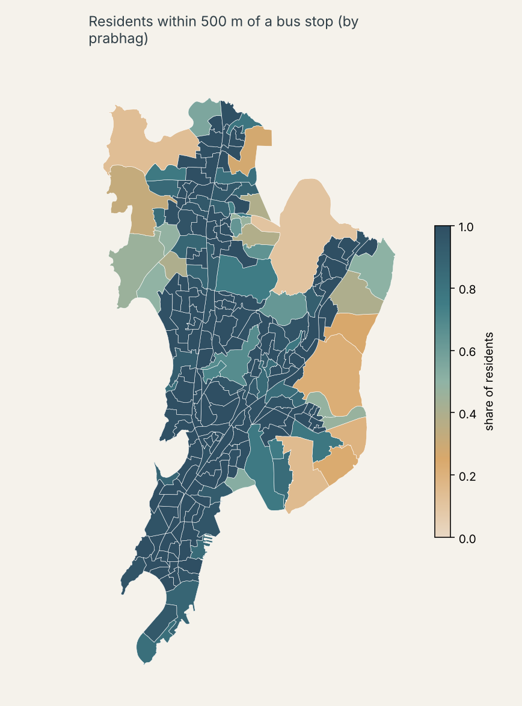
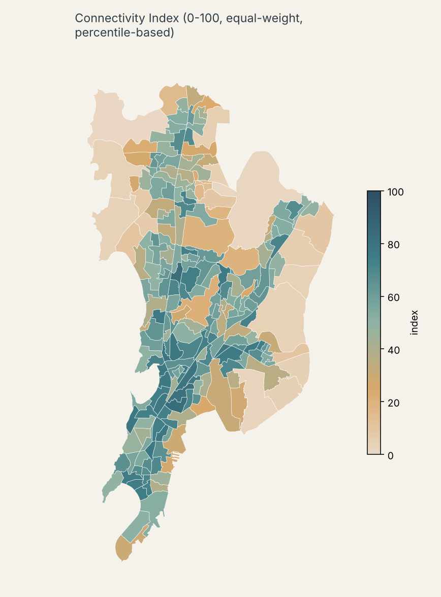
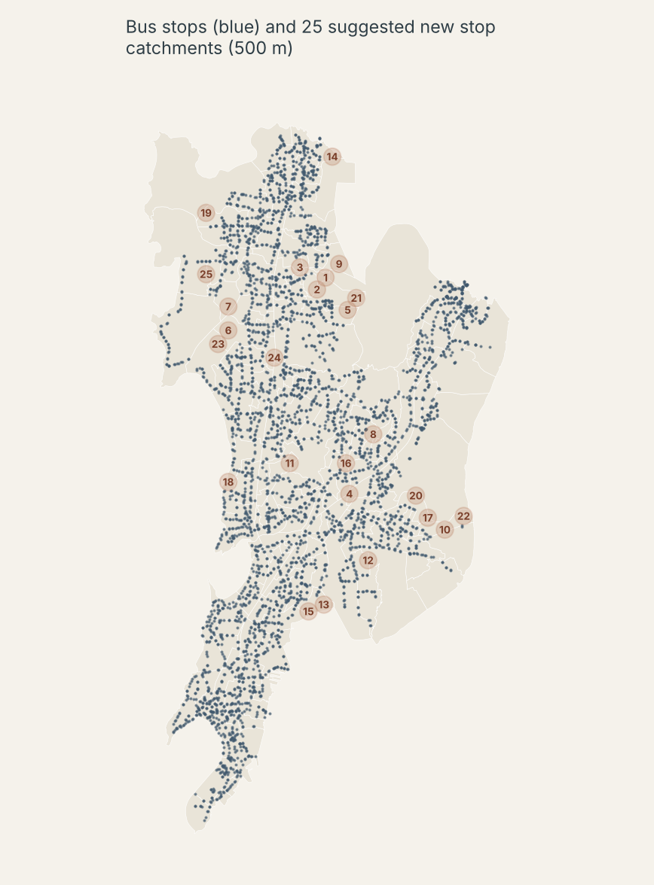
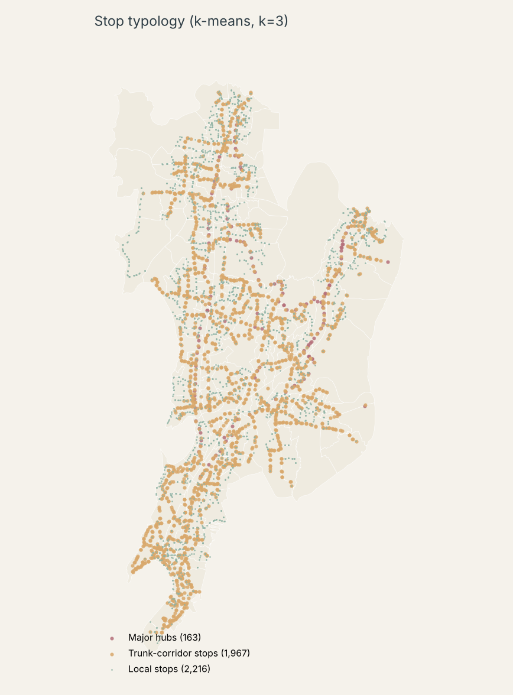

<div align="center">

# 🚌 Mumbai Passenger Mobility Intelligence System

**Scheduled bus journey planning, accessibility & inclusive-mobility analytics for Mumbai - built only on open data.**


</div>

A passenger-friendly application and analysis that answers four questions for Mumbai's public bus network: **How do I get there? Who can reach a bus stop? What does each route offer? Where are the gaps - and what should be fixed first?**
Everything is computed from real, openly licensed data. **No synthetic data, live bus positions, actual arrival times or passenger counts are used or invented.**

<table>
<tr>
<td width="50%"><br/><sub><b>Stop access:</b> share of residents within 500 m of a bus stop, by prabhag</sub></td>
<td width="50%"><br/><sub><b>Connectivity Index</b> (0-100) combining six access and service measures</sub></td>
</tr>
<tr>
<td width="50%"><br/><sub><b>Gap analysis:</b> 25 suggested new-stop catchments (greedy maximum coverage)</sub></td>
<td width="50%"><br/><sub><b>Stop typology:</b> hubs, trunk-corridor and local stops (k-means)</sub></td>
</tr>
</table>

## Quick start
```bash
git clone https://github.com/RaginiGupta21/mumbai-passenger-mobility-intelligence.git
cd mumbai-passenger-mobility-intelligence
python -m venv .venv && .venv\Scripts\activate        # macOS/Linux: source .venv/bin/activate
pip install -r requirements.txt
python -m streamlit run app.py                        # opens at http://localhost:8501
```
Processed data is included, so the app starts immediately. To rebuild everything from public sources (~2-3 min): `bash scripts/run_pipeline.sh`.

## What it does
| Module | Highlights |
|---|---|
| 🧭 **Journey Explorer** | Choose origin, destination, date and time → up to 6 scheduled options with transfers, walking and waiting, a **door-to-door time summary**, an **indicative BEST fare range** and a route map. "Where can I reach in 15-90 min?" map. **Nearest bus stops** tool (click the map, type coordinates or pick a place → distance, walk time, routes, next departures). Engine: RAPTOR over 99,080 scheduled trips with real GTFS calendar logic, including after-midnight trips. |
| ♿ **Accessibility & Inclusion** | Population-weighted stop access at 300 / 500 / 800 m (100 m grid, 12.44 M residents), peak service level, SC/ST and slum-cluster equity, access to colleges and health facilities (with explicit coordinate-uncertainty handling), 09:00 travel-time reach from every prabhag. |
| 🚌 **Routes & Schedules** | 603 active routes: stops on a map, per-trip stop times, hourly timetables, peak headway; stop departure board; service availability by date. |
| 🕸️ **Network Intelligence** | NetworkX components / cut vertices / betweenness; k-means typologies of stops, routes and prabhags; Connectivity Index with sensitivity analysis; Moran's I hotspots; **suggested new-stop catchments**; number-backed recommendations; CSV downloads. |
| 📖 **How to use / Methods** | In-app guide and glossary; sources, GTFS quality audit, methodology and limitations. |

## Headline results (Greater Mumbai, bus network)
- **90.5%** of residents are within 500 m of a bus stop (77.4% within 300 m, 95.4% within 800 m); **~1.18 million** have none within 500 m.
- Gaps are spatially clustered (Moran's I = 0.33, p = 0.001); weakest wards: M-East, T, P-North, R-Central (73-80% coverage).
- Where stops exist, peak service is mostly frequent - only ~67 k residents are covered but get fewer than 4 trips per peak hour.
- SC / ST coverage (88.5% / 85.3%) is a few points below the city (90.5%) but **not statistically significant** at prabhag level.
- The Vasai-Virar (VVMT) network is a **separate component** - no scheduled transfer to BEST/TMT.
- 25 suggested catchments would reach ~381 k of the unserved residents (32%).

Full list: [docs/FINDINGS.md](docs/FINDINGS.md)

## Data (all real - see [docs/DATA_SOURCES.md](docs/DATA_SOURCES.md))
| Layer | Source | Licence |
|---|---|---|
| Bus timetable (BEST, TMT, KDMT, VVMT) | [croyla/mumbai-gtfs](https://github.com/croyla/mumbai-gtfs), valid 19 Aug 2026 - 15 Feb 2027 | MIT |
| 227 BMC wards: population, SC/ST; slum clusters | [DataMeet Municipal Spatial Data](https://github.com/datameet/Municipal_Spatial_Data) | CC BY-SA 2.5 IN |
| Colleges & universities | OpenStreetMap contributors (HOT export) | ODbL |
| Public health facilities | MCGM open data (KML) | MCGM open data |
| BEST fare slabs (indicative) | Press reports, stored in `data/reference/best_fares.json` | Not an official table |

## Honest limitations
Scheduled, not live · bus only (no rail / Metro) · only 7.5% of stop times are official timepoints (the rest interpolated) · one timetable for all 7 days · unofficial community GTFS · walking = straight line × 1.3 (no road network) · uniform population inside each prabhag · OSM colleges incomplete (44) and MCGM health coordinates rounded (~±0.5 km) · fares are indicative only · typologies are descriptive (silhouette 0.29-0.36). Details: [docs/LIMITATIONS.md](docs/LIMITATIONS.md).

## Project structure
```
app.py                    Streamlit entry point
src/                      timetable, RAPTOR router, journey, fares, nearest stops, facilities, maps, ui/ (one module per page)
scripts/00..08_*.py       reproducible pipeline (+ run_pipeline.sh)
data/raw/                 source files          data/reference/   editable fare table
data/processed/           parquet tables, geojson, diagnostics
powerbi/                  Power BI-ready CSV tables + build guide
docs/                     METHODOLOGY · DATA_SOURCES · DATA_QUALITY · FINDINGS · LIMITATIONS · figures/
tests/                    23 pytest checks + 30 headless UI checks
```

## Testing
```bash
python -m pytest -q tests/test_core.py   # integrity, calendar, router never slower than a scheduled trip, itineraries, fares, accessibility
python tests/smoke_all_pages.py          # renders every page and clicks the real controls headlessly
```

## Credits
Contains data © OpenStreetMap contributors (ODbL); DataMeet Trust (CC BY-SA 2.5 IN); MCGM open data; croyla/mumbai-gtfs (MIT). Code released under the [MIT License](LICENSE).

*Built by [Ragini Gupta](https://github.com/RaginiGupta21).*
